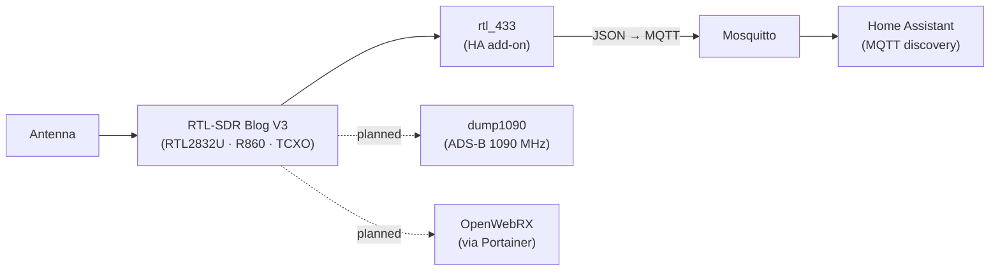

# RTL-SDR RF Exploration: Finding and Decoding the House's Radio Traffic

**A software-defined radio survey of a smart home's 433 MHz and 868 MHz bands: what transmits, what can be decoded, and what needs a different approach. Decoded devices are published to Home Assistant over MQTT. The survey also shaped later projects, sending the heating controls to a purpose-built RAMSES-II gateway and the water meter to supplier data instead of over-the-air decoding.**

> **The short version:** an RTL-SDR Blog V3 running **rtl_433** surveyed the house's sub-GHz bands.
> - **Decoded and live in HA:** a weather sensor and lighting switches/fob (after enabling a protocol that's off by default), published via MQTT.
> - **Heating controls:** clearly visible on 868 MHz but **not decodable** with rtl_433, which led to a dedicated RAMSES-II gateway.
> - **Water meter:** turned out to be **LoRaWAN** on the utility's network, not wM-Bus, so it can't be read locally and supplier data is used instead.
> - **Tyre-pressure sensors** use BLE, not 433 MHz.
> - **Planned next:** ADS-B aircraft tracking and a browser-based SDR receiver.

**Portfolio position:** Field level · RF site survey. The domestic equivalent of surveying a building's wireless systems before choosing an integration route. Related: [Evohome RAMSES-II](https://github.com/the-control-cabinet/evohome-heating-controls-ramses-integration) · [Aico fire/CO interface](https://github.com/the-control-cabinet/aico-ei413-shelly-ha) · [HA integration schedule](https://github.com/the-control-cabinet/home-assistant-integration-schedule)

---

## 1. Objective
- Find out **what's transmitting** in the house on 433 and 868 MHz.
- **Decode** what can be decoded and bring it into HA locally.
- For everything else, decide on the **right integration route**: a dedicated gateway, a relay interface, or supplier data.

## 2. Set-up

| Item | Detail |
|---|---|
| Receiver | **RTL-SDR Blog V3**: RTL2832U with R860 tuner, 1 PPM TCXO (stable frequency), bias tee, SMA connector, dipole antenna kit |
| Decoder | rtl_433, publishing decoded messages as JSON to MQTT |
| Survey | Frequency hopping across 433.92 MHz and the 868 MHz band; noise-floor scan to find active channels |

## 3. Findings

| Band | Target | Result | What happened next |
|---|---|---|---|
| 433.92 MHz | Weather sensor | ✅ Decoded | Live in HA via MQTT |
| 433.92 MHz | Lighting switches and remote fob | ✅ Decoded after **enabling a disabled-by-default protocol** | Fob events available in HA |
| 433/868 MHz | Noise-floor survey | ✅ Mapped | Active channels identified; the busiest 868 MHz activity traced to the water meter |
| 868 MHz | Heating controls (RAMSES-II) | 👁 Seen, not decoded | Purpose-built **RAMSES-II gateway** ([Evohome repo](https://github.com/the-control-cabinet/evohome-heating-controls-ramses-integration)) |
| 868 MHz | Wireless fire/CO alarms | 👁 Seen | Integrated through a **relay interface** instead ([Aico repo](https://github.com/the-control-cabinet/aico-ei413-shelly-ha)) |
| 868.1 MHz | Water smart meter | ❌ Not decodable locally | It's **LoRaWAN** on the utility's network (not wM-Bus), so supplier data is used |
| 868 MHz | wM-Bus (T1 / C1 / S1) | 📚 Researched | Mode differences understood; no wM-Bus meter present |
| BLE | Vehicle tyre-pressure sensors | ❌ Not on 433 MHz | They use BLE; picked up by the BLE proxies instead |
| 1090 MHz | ADS-B aircraft | ⏳ Planned | dump1090 + template sensors |
| Wideband | Web SDR | ⏳ Planned | OpenWebRX in a container |

Data: [data/rf-findings.csv](data/rf-findings.csv)

## 4. Lessons
1. **Survey before you integrate.** Seeing a signal isn't the same as being able to decode it. The survey decided three integration routes.
2. **Decoders often have protocols switched off by default.** Check the decoder's protocol list before assuming a device is unsupported.
3. **Know the physical layer.** "Smart meter on 868 MHz" could be wM-Bus (locally decodable) or LoRaWAN (encrypted, network-operated). The answer changes the whole approach.
4. **Not everything is where you expect.** Tyre-pressure sensors were BLE, not 433 MHz.
5. **Receive-only and passive.** The survey listened only; it never transmitted.

## 5. Roadmap
- [ ] ADS-B receiver (dump1090) with HA sensors for aircraft overhead.
- [ ] OpenWebRX via Portainer for browser-based monitoring.
- [ ] A 24-hour multi-channel capture on 868 MHz to finish the band map.

## 6. Skills demonstrated

| Skill | Evidence |
|---|---|
| RF site survey | 433/868 MHz noise-floor and activity mapping |
| Protocol identification | wM-Bus vs LoRaWAN vs RAMSES-II vs BLE distinguished |
| Integration route selection | Decode, gateway, relay interface or supplier data, chosen per device |
| Edge decoding into a backbone | rtl_433 → MQTT → HA |
| Documentation | Findings register per band and target |

📺 [The Control Cabinet on YouTube](https://www.youtube.com/channel/UC5Cupmz7vlfcodpCX7k8iuQ)

*Built and documented by James · part of [The Control Cabinet BMS portfolio](https://github.com/the-control-cabinet). MIT Licence.*
